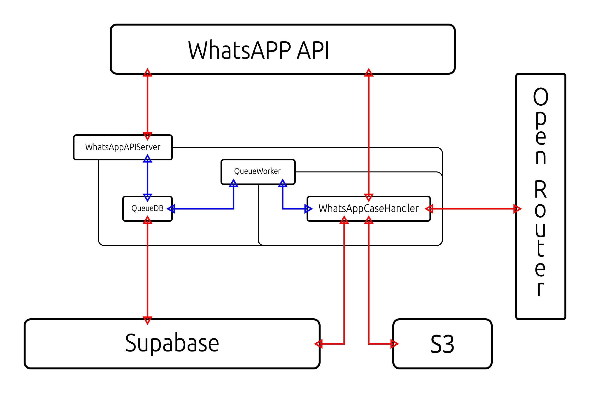

# wa-agents

A Python toolkit for building WhatsApp chatbot backends.

It gives you reusable building blocks for:
- webhook validation and payload parsing,
- queued processing,
- per-user case/context storage in PostgreSQL,
- media storage in S3-compatible buckets,
- idempotent ingestion,
- multi-turn orchestration,
- optional LLM calls (text, images, tools, structured output).

This README is based on:
- [`da-assistant`](https://github.com/luis-i-reyes-castro/da-assistant) (multi-turn + tools + image flow),
- private-safe templates under `docs/`.

## Installation

### As an editable package

```bash
git clone https://github.com/luis-i-reyes-castro/wa-agents.git
pip install -e wa-agents/
```

### As a dependency

Add this line to your `requirements.txt`:
```txt
wa-agents @ git+https://github.com/luis-i-reyes-castro/wa-agents.git@main
```

Then install:
```bash
pip install -r requirements.txt
```

## Runtime Architecture

**TODO: Update diagram**



`wa-agents` is designed around this flow:

1. `WhatsAppAPIListener` receives webhook payload dictionaries and passes them to `AsyncWhatsAppDatabaseQueue`.
2. `AsyncWhatsAppDatabaseQueue` audits and validates each payload, normalizes its messages in PostgreSQL, records available routes, and enqueues eligible messages without choosing a fallback handler.
3. `WhatsAppAPIWorker` runs inside its FastAPI lifespan, drains queue items, calls your `WhatsAppCaseHandler`, and serves synchronous Flow data exchanges without passing them through the message queue.
4. `CaseHandlerBase` (parent of `WhatsAppCaseHandler`) resolves the persisted business/contact identity and handles case open/close logic, context persistence, FSM state, and S3 media access without depending on a messaging transport.
5. `WhatsAppCaseHandler` adds webhook-message conversion, deduplication, WhatsApp media-metadata persistence, API-message linking, and sending helpers.
6. Your `CaseHandlerBase` child class implements business logic in:
    - `process_message(...)` for ingestion-time decisions,
    - `run_while_in_action(...)` for LLM response generation (single or multi-turn).

See [`docs/api_worker_mechanics.md`](docs/api_worker_mechanics.md) for the queue, lease, burst-debounce, and delayed-response lifecycle.

## Environment Variables by Deployment Case

### PostgreSQL storage (required)

Both services use the same database configuration; the combined server uses their union.
Supply one connection URL unless the queue/storage is constructed with an explicit `database_url`.

| Variable                          | Requirement | Value / behavior |
| --------------------------------- | ----------- | ---------------- |
| `SUPABASE_DB_CONNECTION_URL_IPv4` | Preferred URL for listener and worker | PostgreSQL URI, including any required TLS options; works with generic PostgreSQL and Supabase. |
| `SUPABASE_DB_CONNECTION_URL_IPv6` | Alternative URL | Used only when the IPv4-named variable is unset or empty. |

Apply `wa_agents/sql/abc_DDL.sql` to a new PostgreSQL 15+ database with `pgcrypto` available.
Types, domains, tables, and encryption functions are schema-qualified under `wa_agents`.
The DDL's `enable_rls` boolean defaults to `FALSE`; set it to `TRUE` for a Supabase initialization that requires RLS.
False preserves existing RLS settings, and true requires appropriate runtime policies or bypass/ownership in addition to SQL grants.
The canonical DDL can be reapplied at the same schema version; use the intentionally Git-ignored `wa_agents/sql/.migrations/` scripts to upgrade existing schemas.
Apply the schema-names and durable-queue migrations before deploying the ECS recovery changes, with affected services stopped.
The former preserves the shared public domain and encryption functions for other schemas that use them.

### S3-compatible media storage

These settings are required in processes that use media persistence, normally the worker.
Text-only processing does not load the S3 backend.

| Variable                   | Requirement | Value / default |
| -------------------------- | ----------- | --------------- |
| `BUCKET_NAME`              | Required for media | Bucket name. |
| `BUCKET_REGION`            | Required for media | AWS region or S3-compatible provider region. |
| `BUCKET_KEY_ID`            | Only for explicit bucket credentials | Set together with `BUCKET_KEY_SECRET`; omit both for the SDK credential chain. |
| `BUCKET_KEY_SECRET`        | Only for explicit bucket credentials | Secret paired with `BUCKET_KEY_ID`. |
| `BUCKET_ENDPOINT`          | Provider-dependent; see below | Full endpoint URL; omitted with bucket keys defaults to `https://<BUCKET_REGION>.digitaloceanspaces.com`, otherwise the SDK selects AWS S3. |
| `BUCKET_ADDRESSING_STYLE`  | Optional | `auto`, `virtual`, or `path`; defaults to `auto` for SDK-selected AWS, `virtual` for Spaces, and `path` for custom endpoints. |
| `WA_AGENTS_MEDIA_CACHE_MB` | Optional | Process-local cache size in MiB; default `16`, or `0` to disable. |

Every media deployment sets `BUCKET_NAME` and `BUCKET_REGION`; choose its authentication case below.

| Deployment case                      | Additional credential / endpoint settings |
| ------------------------------------ | ----------------------------------------- |
| AWS ECS task role                    | Omit `BUCKET_KEY_ID`, `BUCKET_KEY_SECRET`, and normally `BUCKET_ENDPOINT`; the SDK obtains rotating credentials from the task role. |
| AWS with SDK environment credentials | Set `AWS_ACCESS_KEY_ID` and `AWS_SECRET_ACCESS_KEY`, plus `AWS_SESSION_TOKEN` for temporary credentials; omit both legacy bucket keys and normally `BUCKET_ENDPOINT`. |
| AWS with legacy bucket-key variables | Set both `BUCKET_KEY_ID` and `BUCKET_KEY_SECRET` and an explicit AWS `BUCKET_ENDPOINT`; otherwise the legacy default targets Spaces. Use the SDK credential chain for temporary credentials. |
| DigitalOcean Spaces                  | Set both `BUCKET_KEY_ID` and `BUCKET_KEY_SECRET`; `BUCKET_ENDPOINT` may be omitted to use the region's Spaces endpoint. |
| Another S3-compatible provider       | Set `BUCKET_ENDPOINT` and supply its credentials through both bucket-key variables or the SDK credential chain; adjust `BUCKET_ADDRESSING_STYLE` if required by that provider. |

`AWS_ACCESS_KEY_ID`, `AWS_SECRET_ACCESS_KEY`, and `AWS_SESSION_TOKEN` are consumed by the SDK, not by package-specific configuration.
Uploads omit ACL headers so AWS Bucket owner enforced buckets work; control private access through bucket and IAM policies.

### WhatsApp listener, sending, and Flows

| Variable          | Service | Required when |
| ----------------- | ------- | ------------- |
| `WA_VERIFY_TOKEN` | Listener | Meta verifies the webhook subscription; configure the same value in Meta. |
| `WA_TOKEN`        | Worker / other sending process | Sending or fetching media for an active registration without an Embedded Signup record. |
| `ENCRYPTION_KEY`  | Worker / signup administration | Reading or writing encrypted Embedded Signup business tokens, Flow private keys, or Flow session/exchange data. |
| `ENCRYPTION_KEY`  | Listener | Processing Flow-completion webhook messages, which persist encrypted completion data. Use the same key as the worker. |

A standalone listener processing ordinary messages does not need `WA_TOKEN`, S3 credentials, or an LLM key.
Meta app IDs and app secrets are supplied through the constructor's `apps` definitions, not package environment variables.
The combined server needs all variables applicable to its listener and worker features.
The connection-taking signup functions accept an explicit `secret_key`; their calling application decides how to load it.

Messaging helpers resolve credentials from the sending `phone_number_id`, joining its WABA to `api_embedded_signup_data`.
Connected ES accounts use their encrypted business token.
Missing tokens, disconnected accounts, and decryption failures stop the request; they never fall back to `WA_TOKEN`.
Numbers without an ES record use `WA_TOKEN`.
The sending number must exist in `api_phone_numbers` with `registration_status = active`.

This selection applies to text, templates, interactive messages, Flow launches, contacts, locations, and media uploads/downloads, including direct helper calls.
Helpers accept `database_url` when the caller uses a database other than the default.
`fetch_media()` and `async_fetch_media()` require the sending number's Graph API ID as the keyword argument `operator_id`; the queue worker supplies it automatically.

### Phone registration lifecycle

A Meta `phone_number_id` identifies one registration with a fixed WABA and display number.
A different Meta ID creates a separate row, even when the display number is unchanged.
Contacts, routes, cases, and history stay attached to their registration.

New registrations start as `pending`; webhooks can persist their data but cannot activate them or enqueue bot replies.
After verifying Embedded Signup, the application calls `activate_phone_number()` to activate the new row and retire the previous active row for that display number in one transaction.
Retired registrations cannot send, run queued handlers, or complete Flow sessions, and delayed webhooks cannot reactivate them.

For portfolio-owned numbers provisioned outside Embedded Signup, verify ownership, then call `SyncSupabaseStorage.activate_phone_number(phone_number_id)` or await the same method on `AsyncSupabaseStorage`.
It returns `None` for an unknown or retired registration, or while a handler lease remains active.
Retry after active handlers finish.
Configure the new registration's routes explicitly; previous routes are not copied during onboarding.

### LLM keys (optional, only if using `Agent`)

| Variable                             | Requirement | Value |
| ------------------------------------ | ----------- | ----- |
| `OPENROUTER_API_KEY`                 | Worker when using `Agent` / `AsyncAgent` with its default `api_key_name` | OpenRouter API key. |
| The variable named by `api_key_name` | Instead of the default when the handler selects another name | OpenRouter API key for that agent; this is an application-selected variable name. |

The current `Agent` routes all model calls through OpenRouter; separate provider keys are not used.

### Queue tuning

Poll intervals come from `api_worker_configurations.server_name`, selected by the worker’s `configuration` argument (`worker_config` on the combined server). If that row is missing, the worker uses its class defaults of 1 second. `poll_interval_busy` and `poll_interval_idle` constructor arguments override the row.

Each handler configuration stores the burst timing. `response_delay_seconds` is the base interval for a trailing-edge debounce for delayed handler responses. `max_response_delay_seconds` caps that quiet period, and `burst_decay_minutes` is the time that removes one burst-score point.
While the worker holds a contact lease, each newer queued message is persisted into the same case and restarts the quiet period.
Once the contact remains quiet for the configured interval, the worker calls `run_while_in_action` once with the complete persisted context.
Replies sent directly by `process_message` remain immediate.

Each contact has a persistent **burst score**, initially zero and hard-capped at 10.
An additional customer message received before a successful handler send adds one point.
Each arrival first applies linear decay: `burst_decay_minutes` removes one point over that many minutes. One hour is `60`.
The quiet period is `min(max_response_delay_seconds, response_delay_seconds * 2**score)`.
Ignoring the small decay between rapid messages, a 4-second base and a 60-second maximum give delays of 4, 8, 16, 32, then 60 seconds.
A 1-second base gives 1, 2, 4, 8, 16, 32, then 60 seconds.
The score can keep increasing to 10 while the delay remains 60 seconds, so sustained bursts take longer to recover.
A reply ends the unanswered-message window but does not reset the score.

Scoring uses database queue-arrival times and recorded successful outbound-send times, so messages arriving during generation still count even when processed after the reply.
Any handler send counts as a reply, including progress text; delivery/read receipts are not required.
Text, media, and interactive messages participate. Echoes, imported history, duplicates, and customer messages suppressed during echo silence do not increase the score.
A human echo ends the previous unanswered-message window.
Decay is evaluated lazily on the next eligible arrival and needs no background task.
Stored scores describe their last recorded arrival; subtract elapsed decay when interpreting an idle contact's current score.

The maximum caps the quiet period, not generation time or total burst duration.
Messages that arrive only after the bot has already replied do not build a burst score.
The configuration requires a positive base, a maximum at least as large as that base, and a positive decay period.
Setting the maximum equal to the base gives a fixed quiet period.

Before deploying this version to an existing database, provision the two burst-score tables and the outbound contact/time index from `abc_DDL.sql`.
Use the corresponding incremental migration to upgrade an older schema; reapplying canonical DDL does not add missing columns to existing tables.
Existing contacts start at zero on their first eligible arrival; old messages are not backfilled.
The score/history transaction is idempotent per queue row, including retries after an ingestion failure.

## Minimal App Skeleton

A production app can run as a single FastAPI process:

- `casehandler.py`
- `app.py`

### `app.py`

```python
#!/usr/bin/env python3

from dotenv import load_dotenv

load_dotenv()

from wa_agents.api_server import WhatsAppAPIServer

from casehandler import CaseHandler


# The consumer loads and validates these definitions from its private settings file.
apps = (
    {
      "app"    : "my-bot",
      "id"     : "META_APP_ID",
      "secret" : "META_APP_SECRET",
    },
)
app = WhatsAppAPIServer(
    title              = "WhatsApp Bot",
    apps               = apps,
    handler_cls        = CaseHandler,
    flow_endpoint_path = "/flows/{waba_id}",
)
```

Run it with:
```bash
uvicorn app:app --host 0.0.0.0 --port 8000
```

The server registers GET and POST routes at `/<app>` for every supplied app definition, an independent Flow endpoint, and `GET /healthz` for container health checks.
In this example the callback is `/my-bot` and the Flow endpoint is `/flows/{waba_id}`.
Both listener and combined server verify signatures by default.
Each POST uses a dictionary lookup and checks only the addressed app's secret; another configured app's signature receives `401` before enqueueing.
The library accepts explicit `apps` and does not load app credentials from environment variables.
The application loads app credentials and supplies them through `apps`; `WA_VERIFY_TOKEN` remains the shared verification token.
The old `webhook_path` constructor argument is replaced by `apps`, and the combined server accepts `flow_endpoint_path` separately.
The verification flag is `verify_signatures`; the signature helper is `verify_payload_signature` with keyword-only `app_secret`, `payload`, and `signature` arguments.
`AsyncWhatsAppDatabaseQueue` performs payload auditing, validation, normalization, and enqueueing in the request path; the queue worker starts and stops with the FastAPI lifespan.

The listener and worker can also run as separate FastAPI processes while sharing the same PostgreSQL queue:
```python
from wa_agents.api_listener import WhatsAppAPIListener
from wa_agents.api_worker import WhatsAppAPIWorker


listener = WhatsAppAPIListener( title = "WhatsApp Listener", apps = apps)
worker   = WhatsAppAPIWorker(
    title       = "WhatsApp Worker",
    handler_cls = CaseHandler,
)
```

Each app exposes `GET /`, `GET /healthz`, and `GET /debugz`.
The listener manages its database-pool lifetime, while the worker manages both the pool and its background processing task and exposes `POST /flows/{waba_id}`.
`WhatsAppAPIServer` combines both roles with one shared queue and one lifespan.
Its independent `flow_endpoint_path` defaults to `/flows/{waba_id}`.
Call `validate_listener_routes()` after registering additional business routes so callback collisions fail at startup.

An example container recipe is available at [`docs/Dockerfile.fastapi`](docs/Dockerfile.fastapi).

## Recovery and health

Webhook auditing is durable even when validation fails.
Normalization, message insertion, and enqueueing share a transaction under a payload-row lock; an identical retry resumes an incomplete payload.
Worker handler database ingestion and its delayed reply deadline also commit together.
`ingested_at` and `response_due_at` distinguish pending ingestion from a recoverable response, and a successful newer ingestion replaces or cancels the previous deadline.
Workers reclaim abandoned `processing` rows and unsent responses after the contact lease expires.
The worker reads `api_worker_configurations.max_retries` at startup alongside its poll intervals.
This nonnegative integer counts retries after the initial attempt, separately for ingestion and response; its default of 4 preserves five total attempts, and 0 disables retries.
When no worker configuration is selected or found, the queue also defaults to 4 retries.
Backoff starts at 30 seconds and doubles up to a 300-second cap; exhausted rows remain inspectable and require intervention.
Use the same retry setting on worker replicas serving the same routes; raising it makes previously exhausted work eligible again.
A new ingestion resets the attempt budget for its response phase.
Recovery is at least once: an external send accepted just before a crash may be repeated, and customer tools must make external side effects idempotent.

An independent heartbeat renews all owned contact leases every 20 seconds during slow calls.
Async handler calls time out after 300 seconds; synchronous calls exceeding that bound make the worker unhealthy and retain ownership until their thread finishes or ECS terminates the process.
OpenRouter requests use a 60-second SDK timeout and at most two SDK retries.
Shutdown stops new work and waits up to 30 seconds before cancellation; a Python thread cannot be forcibly cancelled, so ECS must enforce its final stop timeout.
Use a stop timeout greater than the drain interval and retain durable recovery for hard termination.
`/healthz` checks database access, and worker/combined health also checks worker and heartbeat task state.
Keep `/debugz` private.

## Case Handler Routing

Each handler class has a stable `HANDLER_KEY`.
A route maps a business—and optionally one of its contacts—to that key.
Contact-specific routes take precedence over the business default.
Queue rows store the selected route ID. Rows without a route use the queue's configured fallback key.
Ingestion always stores eligible active-registration messages as `pending`, including when no route exists yet.
The listener does not need the worker's fallback key or handler classes.
Workers claim supported routes or their configured fallback; a worker without a fallback leaves unrouted messages pending for another worker or later routing configuration.
`handler_cls` sets that worker's fallback; the corresponding `case_handler_configurations` row must exist.

```python
from wa_agents.api_server import WhatsAppAPIServer
from wa_agents.database_queue import AsyncWhatsAppDatabaseQueue

from casehandlers import (
    FallbackCaseHandler,
    RetailCaseHandler,
)


handlers = {
    RetailCaseHandler.HANDLER_KEY   : RetailCaseHandler,
    FallbackCaseHandler.HANDLER_KEY : FallbackCaseHandler,
}

app = WhatsAppAPIServer(
    handler_classes = handlers,
    queue           = AsyncWhatsAppDatabaseQueue(
        fallback_handler_key = "fallback",
    ),
)
```

Manage routes directly in PostgreSQL for now:
```sql
INSERT INTO wa_agents.case_handler_configurations (
  handler_key,
  case_stale_hours,
  response_delay_seconds,
  max_response_delay_seconds,
  burst_decay_minutes,
  silence_timeout_minutes
)
VALUES (
  'retail',
  48,
  4,
  60,
  60,
  NULL
)
ON CONFLICT (handler_key)
DO UPDATE
SET
  case_stale_hours           = EXCLUDED.case_stale_hours,
  response_delay_seconds     = EXCLUDED.response_delay_seconds,
  max_response_delay_seconds = EXCLUDED.max_response_delay_seconds,
  burst_decay_minutes        = EXCLUDED.burst_decay_minutes,
  silence_timeout_minutes    = EXCLUDED.silence_timeout_minutes,
  updated_at                 = now();

INSERT INTO wa_agents.case_handler_routes_by_phone_number (
  phone_number,
  handler_config
)
VALUES (
  41,
  (
    SELECT id
    FROM wa_agents.case_handler_configurations
    WHERE handler_key = 'retail'
  )
)
ON CONFLICT (phone_number)
DO UPDATE
SET
  handler_config = EXCLUDED.handler_config,
  updated_at     = now();
```

`case_stale_hours` replaces the handler class `DEFAULT_CASE_STALE_HOURS` value for queued WhatsApp work.
`response_delay_seconds`, `max_response_delay_seconds`, and `burst_decay_minutes` are that handler's burst-score base, cap, and decay.
`silence_timeout_minutes` is optional and applies to coexistence numbers; `NULL` disables echo silence.

Message echoes put the selected handler into silence mode when that timeout is set.
Each echo rolls the deadline to one full timeout after that echo is processed.
Customer messages received during silence are persisted for audit without advancing the state machine or agent contexts and do not receive a response.
The open case is closed lazily on the first message after the deadline, and that message starts a fresh case and context.

The canonical DDL defines these objects for new or rebuilt databases.
Apply the relevant scripts in `wa_agents/sql/.migrations/` before deploying schema changes to an existing database.

`handler_url` is reserved for future remote-handler dispatch.
Changing a route affects its pending jobs; deleting it clears their nullable route reference.
A fallback whose key has a configuration row can claim them; otherwise they remain pending.
A route whose key is not served by any worker stays pending.
Before removing a handler deployment, inspect its pending or processing rows:
```sql
SELECT
  cfg.handler_key     AS handler_key,
  que.msg_status      AS msg_status,
  count(*)            AS count,
  min(que.created_at) AS oldest
FROM
  wa_agents.api_to_case_handler_queue           AS que
LEFT JOIN
  wa_agents.case_handler_routes_by_contact      AS ctc ON ctc.id = que.route_by_contact
LEFT JOIN
  wa_agents.case_handler_routes_by_phone_number AS phn ON phn.id = que.route_by_phone_number
LEFT JOIN
  wa_agents.case_handler_configurations         AS cfg
    ON cfg.id = COALESCE(
      ctc.handler_config, phn.handler_config
    )
WHERE
  ( que.msg_status IN ( 'pending', 'processing' ) )
GROUP BY
  cfg.handler_key,
  que.msg_status
ORDER BY
  cfg.handler_key,
  que.msg_status;
```

Workers claim only the keys in their local registry.
A monolith can register every handler; later, separate containers or droplets can register disjoint subsets while sharing the same PostgreSQL queue.

### Edge Case Possibilities Not Yet Addressed

Changing an existing route's configuration intentionally propagates to its pending messages and open cases.
Because the route keeps the same ID, the newly selected handler may continue an open case—including its persisted FSM state and context—that was previously handled by a different handler implementation.
This is acceptable when the handlers use compatible case state, or when route changes happen only while no affected work is active.
If incompatible handlers must be switched while cases are open, add a handler-key or route-revision snapshot to case manifests so the old case can be closed or migrated explicitly.

Similarly, deleting a route sets nullable route references to `NULL`.
If an open case and a later fallback-routed message both have a null route reference, the fallback handler may continue that existing case.
Route changes and deletions are expected to be rare, and queue items normally remain pending only briefly, so these cases are not currently handled specially.

## `CaseHandler` Design Patterns

The WhatsApp patterns below extend `WhatsAppCaseHandler` or `AsyncWhatsAppCaseHandler` and implement:
- `process_message(...) -> bool`
- `run_while_in_action(...) -> bool`

Return semantics:
- `False` means no more immediate response work.
- `True` means worker should run another response pass.

### 1) Single-turn, no tools, no LLM

Template:
- [`docs/example_casehandler_single_turn_no_llm.py`](docs/example_casehandler_single_turn_no_llm.py)

- `process_message`: dedup + ingest, then `return True`.
- `run_while_in_action`: run DB/business logic, send a text, `return False`.

Good for deterministic bots: lookups, status reports, alerts.

### 2) Single-turn, with LLM

Template:
- [`docs/example_casehandler_single_turn_with_llm.py`](docs/example_casehandler_single_turn_with_llm.py)

- `process_message`: gate by whitelist/regex (for example, patient ID).
- `run_while_in_action`: gather external data, optionally call `Agent`, send one answer, then `return False`.

### 3) Multi-turn, with state machine

Used in [`da-assistant/casehandler.py`](https://github.com/luis-i-reyes-castro/da-assistant/blob/main/casehandler.py).

- Define the states and transitions with `CaseHandlerState` and `define_state_machine_config()`, then call `init_machine()`.
- Async handlers fire triggers with `await self.trigger(...)`.
- [`context_build()`](wa_agents/case_handler_base.py) restores the persisted state directly without replaying old messages.
- [`apply_and_persist_message()`](wa_agents/case_handler_base.py) applies a message, persists it with the resulting state, and then runs queued transition callbacks.
- [`run_while_in_action()`](https://github.com/luis-i-reyes-castro/da-assistant/blob/main/casehandler.py) checks the current state's `while_in` actions and routes to step handlers.
- Each step can decide whether to continue (`True`) or wait for user (`False`).

Use `on_enter` and `on_exit` for delayed transition callbacks: they run only after the triggering message and resulting state are durable.
Context changes that must be persisted with the triggering message belong in `apply_message_to_state_machine()`.
Use `while_in` for manually dispatched response-generation actions such as `ask_for_*` and `call_*_agent`.

A trigger without a matching transition returns `False`, leaves the state unchanged, and queues no callbacks.
Remaining in a state does not rerun `on_enter`; its `while_in` actions remain available to `run_while_in_action()`.

#### Debugging persisted state

`case_handler_state_histories` stores an append-only snapshot timeline.
The first row for a case has no `case_message` and records its initial state.
Each subsequently persisted case-handler message adds one row containing the resulting state, including unchanged or `NULL` states.
Manifest-only updates, such as closing a case, do not add a snapshot.

Query a case timeline directly in PostgreSQL:
```sql
SELECT
  history.id            AS id,
  history.created_at    AS created_at,
  message.message_index AS message_index,
  message.ts            AS message_ts,
  history.machine_state AS machine_state,
  message.basemodel     AS basemodel,
  message.origin        AS origin
FROM
  wa_agents.case_handler_state_histories AS history
LEFT JOIN
  wa_agents.case_handler_messages AS message ON
    ( message.case_id = history.case_manifest ) AND
    ( message.id      = history.case_message  )
WHERE
  ( history.case_manifest = 123 )
ORDER BY
  history.id;
```

### 4) Multi-turn, with tool calls

Used in [`da-assistant/casehandler.py`](https://github.com/luis-i-reyes-castro/da-assistant/blob/main/casehandler.py) (`call_match_agent`, `call_main_agent`) and mirrored in:
- [`docs/example_casehandler_multi_turn_tools.py`](docs/example_casehandler_multi_turn_tools.py)

Loop shape:

1. Call agent.
2. Persist the assistant message with `apply_and_persist_message()` and send the returned message.
3. If there are no `tool_calls`, stop.
4. Execute tool calls in your tool server.
5. Store a `ToolResultsMsg` in context.
6. Return `True` so `run_while_in_action()` runs again with updated context.

WhatsApp `send_text()`, `send_interactive()`, and `send_template()` require the persisted message returned by `apply_and_persist_message()`.
Persisting first leaves a durable case-handler message without a `case_handler_to_api_bridge` mapping when outbound sending does not complete.

### Templates with media or location headers

`ServerTemplateMsg` accepts one optional header: `document`, `image`, `video`, or `location`.
Match it to the header type of the approved template in the sending WABA.
Omit `parameters` when the approved body has no variables.

Images and videos use `WhatsApp_OB_TemplateImage` and `WhatsApp_OB_TemplateVideo`.
Each accepts exactly one of `id` (uploaded media ID) or `link` (a URL accessible to Meta).
For example, persist and send these through the existing `apply_and_persist_message()` and `send_template()` methods:
```python
from wa_agents.case_handler_models import ServerTemplateMsg
from wa_agents.io_models import (
    WhatsApp_OB_TemplateImage,
    WhatsApp_OB_TemplateLocation,
    WhatsApp_OB_TemplateVideo,
)

image_template = ServerTemplateMsg(
    name     = "product_photo",
    language = "es_EC",
    image    = WhatsApp_OB_TemplateImage( link = "https://example.com/product.jpg"),
)
video_template = ServerTemplateMsg(
    name     = "product_demo",
    language = "es_EC",
    video    = WhatsApp_OB_TemplateVideo( id = video_media_id),
)
location_template = ServerTemplateMsg(
    name     = "pickup_location",
    language = "es_EC",
    location = WhatsApp_OB_TemplateLocation(
        latitude  = -2.17,
        longitude = -79.92,
        name      = "Pickup point",
        address   = "Main street 123",
    ),
)
```

For image/video bytes, use `upload_whatsapp_media()` or `async_upload_whatsapp_media()` with a `ServerMediaMsg` containing `filepath`, `content`, and `mime` (for example, `image/jpeg` or `video/mp4`), then pass the returned ID to the matching header class.

Locations require latitude, longitude, name, and address.
Coordinates are validated and serialized as strings in the header payload.
Meta supports fixed location headers on utility and marketing templates; see [Meta's template components](https://developers.facebook.com/documentation/business-messaging/whatsapp/templates/components).

Header references and location details survive case-message persistence and appear in the outbound audit.
Sending works through both sync and async handlers.

#### Document templates

Use an approved template with a `DOCUMENT` header.
`ServerTemplateMsg.document` accepts a `WhatsApp_OB_TemplateDocument` containing exactly one of `id` (an uploaded PDF's media ID) or `link` (a PDF URL accessible to Meta), plus an optional `filename`.

For a generated PDF, upload its bytes first, then persist and send the template:
```python
from wa_agents.case_handler_models import (
    ServerDocumentMsg,
    ServerTemplateMsg,
)
from wa_agents.io_functions import async_upload_whatsapp_media
from wa_agents.io_models import WhatsApp_OB_TemplateDocument

media_id = await async_upload_whatsapp_media(
    operator_id  = self.operator_id,
    media        = ServerDocumentMsg( filepath = "invoice.pdf", content = pdf_bytes),
    database_url = self.storage.database_url,
)
message = await self.apply_and_persist_message(
    ServerTemplateMsg(
        name       = "invoice_document",  # Approved template name in this account.
        language   = "es_EC",
        parameters = [ customer_name ],    # Match the approved body's variables.
        document   = WhatsApp_OB_TemplateDocument( id = media_id, filename = "invoice.pdf"),
    )
)
await self.send_template(message)
```

For an existing hosted PDF, supply `link = "https://example.com/invoice.pdf"` instead of `id` and skip the upload.
Synchronous handlers use `upload_whatsapp_media()` and their existing synchronous persistence/send methods.
Uploads and sends select credentials using the same ES lookup rule.

The persisted message and outbound audit contain the document reference and filename.
The upload helper does not archive PDF bytes in S3 or Supabase; retain the original document in the application's document storage if it is needed later.
Media IDs must belong to the sending account and remain valid when sending.

## Non-WhatsApp Case Handlers

The models in `case_handler_models.py` and the `Agent` classes are not tied to a WhatsApp transport.
For a stateless API handler, build the context directly from `Message` subclasses, call the agent, and return its result.
There is no need to instantiate `CaseHandlerBase` or create WhatsApp API database records.

A non-WhatsApp handler can reuse `CaseHandlerBase` or `AsyncCaseHandlerBase` when it needs persisted messages, case manifests, or FSM state.
The current persistence schema identifies cases through `api_contacts`, so this setup requires placeholder business and contact rows in `api_businesses` and `api_contacts`.
Construct the core handler with those rows or their IDs, then use `case_handler_models.Message` subclasses for the actual API input and output.

In this mode:

- Implement `process_message()` as a no-op to satisfy the abstract interface.
- Persist messages with `apply_and_persist_message()` and load them with `context_build()`.
- Do not call `dedup_and_ingest_message()` or the WhatsApp `send_*()` methods.
- No row is written to `case_handler_to_api_bridge`; that mapping is populated only by the WhatsApp ingestion and sending paths.
- Start a fresh case for every API call and close it in a `finally` block when the call completes.
  Before opening it, close or recover any case left open by an interrupted earlier call.

The schema permits only one open case per contact.
Calls sharing one placeholder contact must therefore be serialized.
If requests may overlap, use separate placeholder contacts for their independent concurrency keys.

## WhatsApp Payload Data You Can Use

The parsed payload model is `WhatsApp_IB_Payload`.

`ServerMsg.user_eyes=True` marks a message meant only for the end user, for example transient UX text like "Thinking..." or "Looking up in database...".
These messages are excluded from LLM-readable context.

`dedup_and_ingest_message()` maps normal inbound messages to `HumanUserMsg` subclasses and WhatsApp Business message echoes to `HumanServerMsg` subclasses.
An echo starts or extends durable silence for the open case.
Always check for a falsey result or `HumanServerMsg` before sending unsupported-message replies or doing other ingestion-time work.
A falsey result can mean a duplicate or a customer message that was persisted while silence was active.

Most routing happens in `WhatsApp_IB_Message` fields:
- `message.type`: `text`, `interactive`, `image`, `video`, `audio`, `sticker`, etc.
- `message.text.body`: user text content.
- `message.interactive.choice`: selected button/list option.
- `message.media_data`: normalized media descriptor for image/video/audio/sticker.
- `message.context`: replied-to message metadata.

Also useful:
- `message.user`: sender phone.
- `contact.wa_id` and `contact.profile.name`.
- `value.metadata.phone_number_id` and `display_phone_number`.

Example branch logic in `process_message`:
```python
from wa_agents.case_handler_models import HumanServerMsg
from wa_agents.io_models import (
    WhatsApp_IB_Message,
    WhatsApp_IB_MessageEcho,
)


def process_message(
    self,
    message       : WhatsApp_IB_Message | WhatsApp_IB_MessageEcho,
    media_content : MediaContent | None = None,
) -> bool :
    
    msg = self.dedup_and_ingest_message( message, media_content)
    if not msg :
        return False

    if isinstance( msg, HumanServerMsg) :
        return False

    if message.type == "interactive" :
        # user selected a button/list option
        return True

    if message.type == "image" :
        # process media metadata/caption
        return True

    if message.type != "text" :
        # optionally send unsupported-type message
        return False

    # text flow
    return True
```

## Agent Usage Recipes

Constructor behavior:
- pass a single OpenRouter model string, or
- pass a `list[str]` to enable OpenRouter fallback models;
- pass `api_key_name="CUSTOM_ENV_VAR"` to use a scoped OpenRouter key instead of `OPENROUTER_API_KEY`.

### 1) Plain text completion

```python
from wa_agents.agent import AsyncAgent
from wa_agents.case_handler_models import HumanUserContentMsg

agent = AsyncAgent( "main", [ "openai/gpt-5-mini" ])
agent.load_prompts([ "prompts/main.md" ])

context = [ HumanUserContentMsg( text = "Hello, summarize this ticket.") ]
resp    = await agent.get_response( context = context, max_tokens = 400)
```

### 2) With tools

```python
agent = AsyncAgent( "main", [ "openai/gpt-5-mini" ])
agent.load_prompts([ "prompts/main.md" ])
agent.load_tools([ "agent_tools/main_openai.json" ])

resp = await agent.get_response( context = context)
if resp and resp.tool_calls :
    # execute tool calls, create ToolResultsMsg, append to context, call again
    ...
```

Note: pass a list of models to enable OpenRouter fallback models.

### 3) Structured output

```python
from pydantic import BaseModel


class TicketSummary (BaseModel) :
    
    summary  : str
    severity : str

resp = await agent.get_response( context = context, output_st = TicketSummary)
if resp and resp.st_output :
    data = resp.st_output
```

### 4) Image + text context

```python
from wa_agents.case_handler_models import (
    HumanUserContentMsg,
    load_media,
)

media   = load_media("tests/photo.jpg")
context = [ HumanUserContentMsg( text = "Describe this issue.", media = media) ]

resp = await agent.get_response(
    context   = context,
    load_imgs = True,
)
```

## Case and Storage Behavior (built in)

`CaseHandlerBase` and `AsyncCaseHandlerBase` provide:

- business/contact lookup when constructed with database row IDs,
- per-user data lookup from the resolved contact (`UserData`),
- stale-case rollover (`case_stale_hours` from the handler configuration, or `DEFAULT_CASE_STALE_HOURS`, default 48h),
- case manifests reconstructed from stored message rows,
- context replay into your optional handler state machine,
- S3 access and stored-media hydration,
- persisted FSM state, and
- contact leases.

`WhatsAppCaseHandler` and `AsyncWhatsAppCaseHandler` additionally provide:

- idempotent inbound-message ingestion,
- WhatsApp media-metadata persistence,
- WhatsApp API message linking, and
- send helpers for text, templates, and interactive messages.

Supabase stores:
- incoming queue rows in `wa_incoming_queue`,
- validated webhook payloads in `wa_webhook_payloads`,
- exploded webhook messages/statuses in `wa_webhook_messages` and `wa_webhook_statuses`,
- caseflow users/cases/messages in `wa_users`, `wa_cases`, and `wa_messages`.

S3-compatible bucket storage is only used for media bytes:
```txt
<phone_number_id>/
  <contact_user_id>/
    <case_index>_<message_index>.<extension>
```

Case and message indices are one-based insertion ordinals.

## Reference Implementations

Use these as templates when building new bots:

- [`da-assistant`](https://github.com/luis-i-reyes-castro/da-assistant)
  - Multi-turn chatbot.
  - Uses built-in case-handler state-machine support + staged agent calls + tool call loop.
  - Includes image flow and interactive model selection.

- [`docs/examples_chatbot_patterns.md`](docs/examples_chatbot_patterns.md)
  - Local templates for single-turn and multi-turn handlers.
  - Replaces references to private implementations.

## Local Webhook Introspection

For payload exploration only, see:
- [`docs/instructions_whatsapp_api.md`](docs/instructions_whatsapp_api.md)
- [`docs/instructions_demo_webhook.md`](docs/instructions_demo_webhook.md)
- [`docs/demo_webhook.py`](docs/demo_webhook.py)

These are useful when mapping incoming WhatsApp JSON to your bot routing logic.

## WhatsApp Flows

The worker exposes an encrypted data endpoint at its explicit `flow_endpoint_path`.
The default `/flows/{waba_id}` endpoint is independent of the per-app webhook paths.
Flow requests are routed to the class registered under the Flow definition's `handler_key`; the class implements method `handle_flow_request()` with a `WhatsApp_Local_FlowContext` and `WhatsApp_IB_Decrypted_FlowRequest`, and returns a `WhatsApp_Local_FlowHandlerResult`.

Apply `wa_agents/sql/abc_DDL.sql` before provisioning.
The schema stores:

- one RSA key pair per WABA, with the private key encrypted by `ENCRYPTION_KEY`;
- manually registered Flow definitions;
- expiring, single-user launch sessions and encrypted application state;
- encrypted endpoint request/response audits with idempotent retry replay; and
- Meta Flow lifecycle, health, and error webhook events.

Generate a key pair, persist it, upload its public key to every phone number in the WABA, and verify Meta's `VALID` signature status with:
```bash
python -m wa_agents.flows \
  --waba-id 123456789 \
  --phone-number-id 111111111 \
  --phone-number-id 222222222
```

This command uses `ENCRYPTION_KEY`, `WA_TOKEN`, and the configured Supabase connection URL.
Subscribe the Meta app to both the `messages` and `flows` webhook fields.
Flow JSON publication remains a manual Meta Flow Builder step; after publication, register its ID and handler with `AsyncSupabaseStorage.upsert_flow()` (or the synchronous equivalent).

Flow launch tokens are encrypted in session storage and redacted from ordinary outbound-message JSON.
Decrypted endpoint payloads, application state, and responses are encrypted at rest.
The endpoint returns HTTP 421 for transport decryption failures and HTTP 432 for invalid, expired, or superseded sessions.

### Flow Media Uploads

PhotoPicker and DocumentPicker uploads are exposed lazily.
The worker and Flow endpoint do not download files unless the application handler requests them.

For a completed Flow, read the component-keyed descriptors from the `nfm_reply` and fetch their Graph media IDs in parallel:
```python
import asyncio

from wa_agents.io_functions import async_fetch_media


reply = message.interactive.nfm_reply
items = reply.media.get( "photo_picker", []) if reply else []
files = await asyncio.gather(
    *( async_fetch_media( item, operator_id = self.operator_id) for item in items )
)
```

For a `data_exchange`, files are encrypted on Meta's CDN.
Fetch and decrypt each typed descriptor inside `handle_flow_request()`:
```python
import asyncio

from wa_agents.flows import async_fetch_flow_cdn_media
from wa_agents.io_models import WhatsAppFlowMediaError


items   = request.media.get( "document_picker", [])
results = await asyncio.gather(
    *( async_fetch_flow_cdn_media(item) for item in items ),
    return_exceptions = True,
)
files  = {}
errors = {}
for item, result in zip( items, results) :
    if isinstance( result, WhatsAppFlowMediaError) :
        errors[str(item.media_id)] = "No se pudo verificar el archivo."
    elif isinstance( result, Exception) :
        raise result
    else :
        files[str(item.media_id)] = result
```

Expose `errors` through the Flow response field bound to the picker's `error-message`.
The exception is intentionally sanitized and never contains the signed CDN URL or encryption keys.
Applications remain responsible for validating content types, scanning untrusted files, and storing accepted bytes.
Meta enforces the picker file-count and size limits; these helpers verify transport and content integrity but do not add local limits.

## Embedded Signup persistence

`wa_agents.supabase` provides connection-taking `async_*` functions for Embedded Signup sessions, WABA credentials, phone metadata, app-data sync requests, operator reads, and handler-route assignment.
They execute packaged SQL using the supplied `Async_DB_Connection` and leave commit/rollback to the caller, allowing applications to combine WhatsApp writes with their own schema writes atomically.
`async_upsert_waba()` and `async_get_waba_token()` require an explicit `secret_key`; applications retain responsibility for loading that secret.
Signup `id_biz` and `id_user` values are application identifiers stored in `application_data`; these queries access only the `wa_agents` schema.

These administration functions serve different purposes from the storage adapters used during webhook processing.
`async_get_waba_token()` looks up credentials by application business ID and WABA ID, while the adapters' `get_business_token()` resolves a sending phone registration and enforces its active, connected status.
`async_upsert_waba()` and `async_upsert_phone_number()` maintain signup credentials and phone metadata, while the adapters' `upsert_business()` records webhook identities without replacing that metadata.
