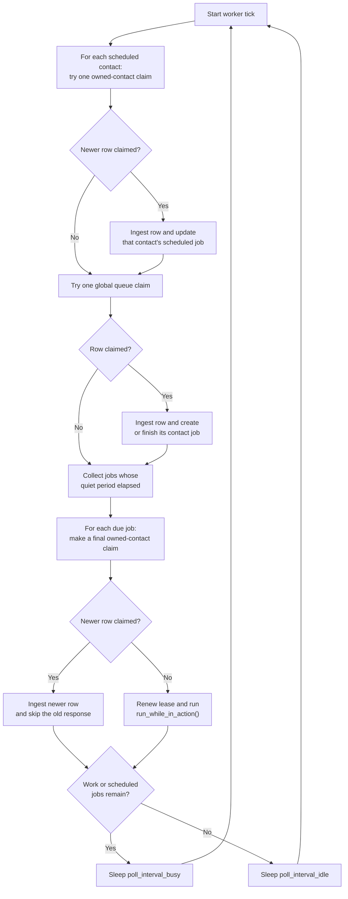
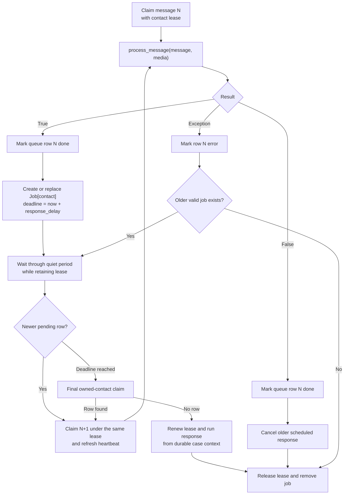

# API Worker Mechanics

`WhatsAppAPIWorker` turns normalized WhatsApp queue rows into durable case-handler
messages and delayed responses. The worker runs as an asynchronous task for the
FastAPI application lifespan. `WhatsAppAPIServer` combines it with the webhook
listener, while `WhatsAppAPIWorker` can also run separately against the same
PostgreSQL queue.

## Main Loop

Each worker tick performs three operations in order:

1. Advance active contact bursts by claiming at most one newer message for each
   contact that already has a delayed response.
2. Claim one globally pending message for a contact that does not have an active
   lease.
3. Run delayed responses whose quiet-period deadlines have elapsed.

The worker uses the busy poll interval while any delayed responses exist. When
there is no active or newly processed work, it uses the idle poll interval.



## Global Queue Claim and Contact Lease

The global queue claim atomically selects the oldest compatible pending row,
marks it `processing`, and acquires a 90-second lease for its contact. PostgreSQL
row locking and `SKIP LOCKED` allow multiple workers to share the queue without
claiming the same row or concurrently processing the same contact.

The queue row already contains the handler route selected when the message was
enqueued. The claim resolves that route to a registered handler key and reads any
handler-specific silence-timeout setting. A worker only claims routes present in
its handler registry.

The lease owner token travels with the `HandlerJob`. Handler instances use that
token to renew or release the lease; a different worker or stale job cannot take
over an unexpired lease.

## Message Ingestion

For every claimed queue row, the worker:

1. Reconstructs the WhatsApp message, business, contact, handler route, and
   silence timeout.
2. Fetches media bytes when the message contains media.
3. Creates the routed handler and calls `process_message(message, media)`.
4. Marks the queue row `done` after successful ingestion.

`process_message()` is responsible for deduplication, case selection, state
machine transitions, and durable message/context persistence. Its return value
is the worker contract:

- `True`: the handler needs a delayed `run_while_in_action()` response.
- `False`: ingestion completed the work and no delayed response is needed.

A `done` queue row means ingestion succeeded; it does not mean that a delayed
response has already been generated or sent.

## Trailing-Edge Response Debounce

Delayed responses are stored in memory with at most one scheduled job per
contact. `response_delay` is a quiet period measured from the latest successfully
ingested message that requested a response.

While the quiet period is active, the worker retains the contact lease and uses
it to claim the contact's next pending row in strict FIFO order. This owned-contact
claim reuses the owner token and refreshes the lease heartbeat. It does not skip
an incompatible handler at the head of the contact queue.

After a newer message is ingested:

- A `True` result replaces the contact's scheduled job with the newer job and
  restarts the quiet-period deadline.
- A `False` result cancels the scheduled response and releases the lease. This
  covers messages handled immediately during ingestion and message echoes that
  should suppress an automated response.
- An exception marks only the newer queue row `error`. The previous valid job,
  deadline, and lease remain in place so the earlier response is not lost.

The worker processes at most one additional row per active contact per tick for
fairness between contacts. Immediately before running a due response it makes a
final owned-contact claim attempt. If a newer row is found, that row is ingested
and the older response does not run.

Messages for different contacts have independent jobs, deadlines, and leases. A
continuous stream of messages keeps resetting one contact's deadline; there is
no maximum burst duration.



### Example: four messages three seconds apart

Assume `response_delay = 5.0` and `process_message()` returns `True` for every
message. If one contact sends four `Hola` messages three seconds apart, each
successful ingestion replaces the same contact job and restarts its deadline:

```text
t=0s   Hola -> ingest, schedule response for t≈5s
t=3s   Hola -> ingest, replace job, reschedule for t≈8s
t=6s   Hola -> ingest, replace job, reschedule for t≈11s
t=9s   Hola -> ingest, replace job, reschedule for t≈14s
t≈14s  quiet period ends; run the handler once using all four messages
```

All four messages are persisted in the same case, the contact lease remains held
through the burst, and `run_while_in_action()` runs once with all four messages in
the durable context. The user receives that single reply after the quiet period
plus the time required for response generation and the WhatsApp API call.

If any ingestion returns `False`, such as for an echo or a message handled with an
immediate reply, the worker cancels the scheduled delayed response instead.

## Response Execution

When the contact is quiet and its job is due, the worker renews the contact
lease and reconstructs the handler from the latest job. The handler builds its
context from durable storage, so the response sees every message persisted
during the burst.

The worker calls `run_while_in_action()` until it returns `False`. If it returns
`True`, the lease is renewed before the next action. The lease and in-memory job
are released after completion, lease loss, or a response exception.

An inbound message that arrives after response execution begins belongs to a new
burst. The worker does not cancel an LLM or outbound API call already in progress.

## Echo Silence

WhatsApp message echoes use the same queue and lease path. The case handler
persists an echo as server-originated context, extends `silenced_until` using the
handler-specific or fallback silence timeout, and returns `False`. The worker
therefore cancels any scheduled automated response and releases the lease.

While a case is silenced, inbound user messages are persisted without applying
them to the state machine or scheduling a response. Expired silence closes the
old case during the next case decision.

## Failures and Recovery Boundaries

- Ingestion failures mark the claimed row `error` and release its lease unless
  an older valid delayed job still owns that lease.
- Response failures are logged, after which the lease and scheduled job are
  released.
- Missing or expired leases prevent stale jobs from responding.
- Queue rows, cases, messages, state, and contexts are durable in PostgreSQL.
- Delayed response deadlines are process-local. A worker restart after a queue
  row is marked `done` can lose its unsent delayed response; the abandoned lease
  expires after 90 seconds. Durable response scheduling is outside the current
  worker model.

## Timing Configuration

Timing values can be passed to the worker/server constructor. When omitted, the
polling values and response delay read their `QUEUE_*` environment variables and
then use package defaults. The silence timeout additionally supports a durable
per-handler database override, which takes precedence over the worker fallback.

The relevant settings are:

- `poll_interval_busy`: sleep between ticks while work or delayed jobs exist.
- `poll_interval_idle`: sleep between ticks while the worker is idle.
- `response_delay`: required quiet period after the latest burst message.
- `silence_timeout`: fallback duration for message-echo silence.
